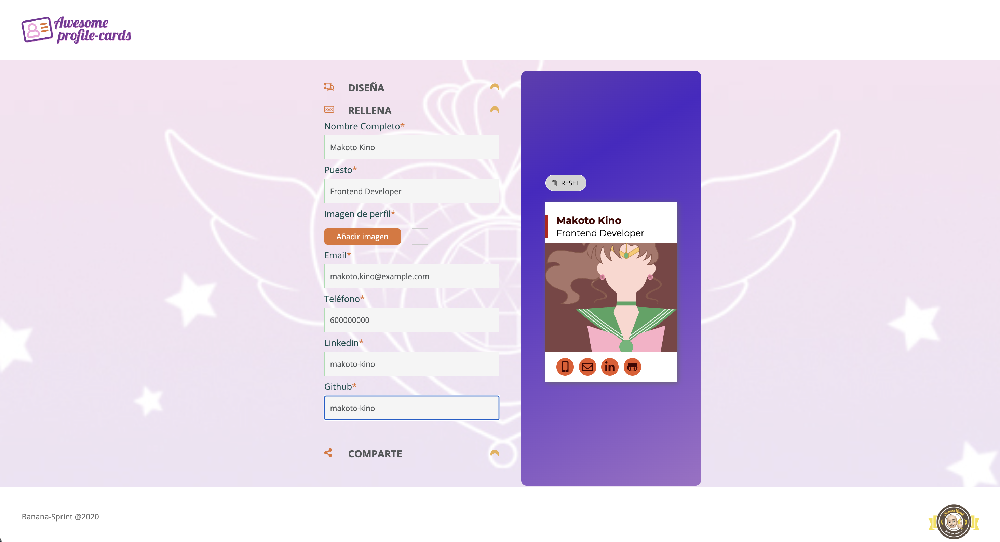

# Sailor Moon Cards (React refactor)

Team refactor done during the [Adalab](https://adalab.es/) bootcamp: we took another team's project, a web app to create business cards with a Sailor Moon theme (the same idea as [Kard.MA Cards](https://github.com/amandapalma/Kard.MA-Cards), with a different look), and migrated it from JavaScript ES6 to React. We worked on it together as a team, using mob programming (one person writes the code while the rest of the team guides and reviews).

**Original project:** https://github.com/saraalite/project-promo-j-module-3-team-2
**Demo:** https://amandapalma.github.io/Sailor-Moon-Cards-Refactoring/

## Stack

- [React](https://reactjs.org/) with [React Router](https://reactrouter.com/)
- [Sass](https://sass-lang.com/) for styles

## Known issues

This is a 2020 bootcamp project that is no longer maintained. In the deployed demo:

- The footer logo link leads to a 404 page.
- The Share button does not work: the request to the external bootcamp backend fails (CORS error).
